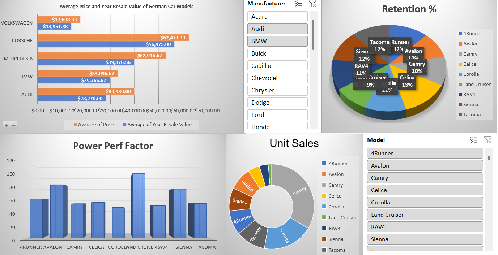

# Car Sales Dashboard | Microsoft Excel

An Excel visualization portfolio project exploring car sales, vehicle pricing, resale value, and performance measures.

## Dashboard preview

## Project files

| File | Purpose |
| --- | --- |
| [dashboards .xlsx](<dashboards .xlsx>) | Dashboard workbook to review first |
| [dashboards Car_Sales_Kaggle_DV0130EN_Lab3_Start.xlsx](<dashboards Car_Sales_Kaggle_DV0130EN_Lab3_Start.xlsx>) | Additional workbook supplied with the project |
| [image.png](<image.png>) | Dashboard screenshot |

The workbook filenames above match the files committed to this repository.

## Explore the project

1. Download the dashboard workbook and open a local copy in Microsoft Excel.
2. Review the worksheet names, source columns, chart labels, and any available filters.
3. Compare sales, price, resale value, and performance measures using their stated units.
4. If you edit the data, refresh any PivotTables and check that chart ranges include the intended rows.

## Analytical interpretation

Resale-value retention and customer retention are different measures. Confirm the workbook's definition of retention before interpreting a percentage. Cross-sectional model comparisons should not be described as time trends unless the source includes a suitable time series.

## Tools and scope

Microsoft Excel · charts · dashboard presentation

The repository includes workbooks and a preview image. The workbook calculations and interactive controls have not been independently validated in this documentation update. No separate license file is currently included.

## Author

[Muhammad Ibrahim](https://www.linkedin.com/in/m135ibrahim/) · [GitHub portfolio](https://github.com/M33ibrahim)
